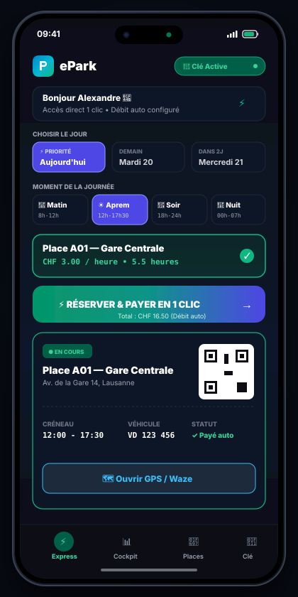
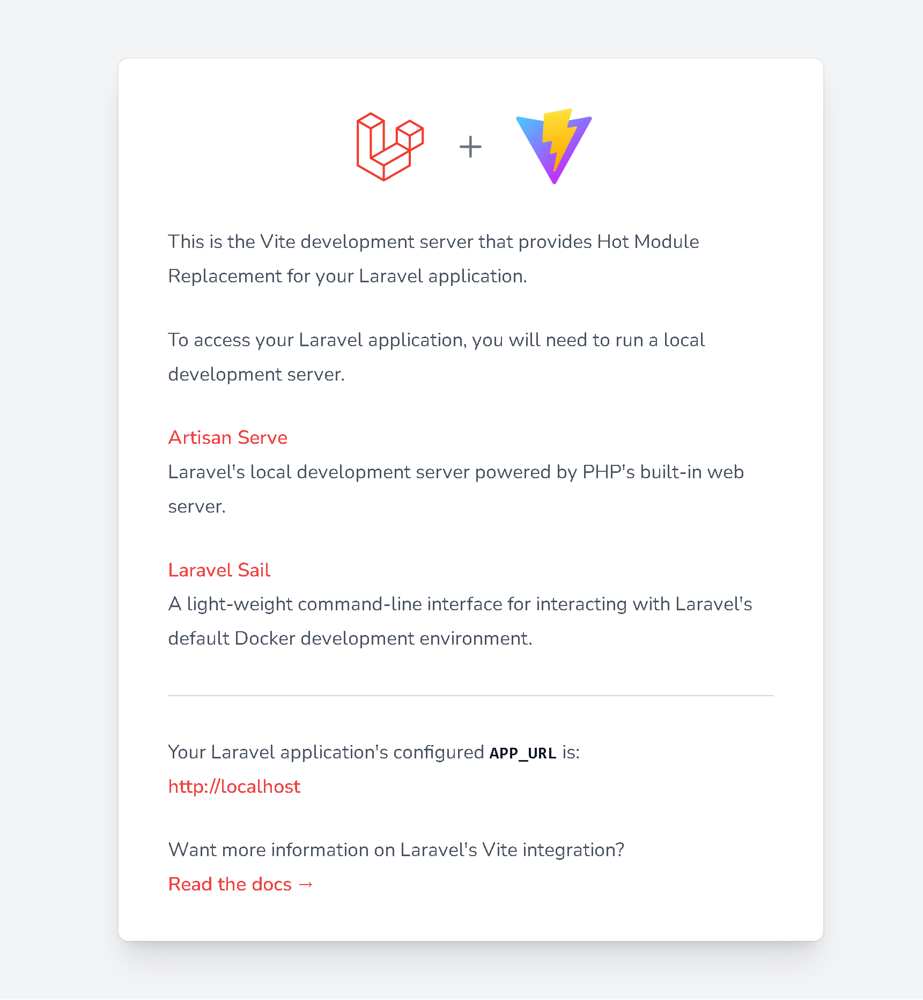

# ePark

Plateforme de réservation de places de parking entre particuliers et gestionnaires de sites. ePark simplifie la mise à disposition de places, l’onboarding des utilisateurs et le suivi complet des réservations (paiement, confirmation propriétaire, feedback).

## Objectifs

- Réduire la friction de réservation et de mise à disposition.
- Clarifier le statut des réservations à chaque étape.
- Offrir un parcours utilisateur simple et guidé.

## Parcours utilisateur (référence)

1. Connexion
2. Onboarding simplifié : choisir un site existant OU créer un site favori
3. Réservation : site favori pré‑sélectionné
4. Confirmation propriétaire avec message optionnel
5. Feedback après réservation terminée

## Fonctionnalités clés

- Onboarding en une page avec choix du site favori
- Réservation par date et segment (matin/apm/soir)
- Disponibilités avancées des places + exceptions
- Delai d'annulation configurable (12h/24h)
- Validation/refus propriétaire avec message
- Modification de reservation (locataire, en attente)
- Paiement et statuts associés
- Feedback à chaud après fin de réservation
- Tableau de bord et indicateurs principaux
- Statistiques admin (top places, occupation)
- Gestion des sites, places et profils

## Statuts de réservation

- En attente
- Confirmée
- Annulée
- Terminée (confirmée + date de fin passée)

## Rôles

- Locataire : réserve une place
- Propriétaire : propose des places et valide/refuse
- Admin : visibilité globale

## Stack technique

- Laravel 12
- Blade + Alpine.js
- Tailwind CSS
- MySQL/MariaDB
- SQLite (dev)

## Démarrage rapide

1. Installer les dépendances PHP et Node
2. Configurer le fichier .env
3. Générer la clé d’application
4. Lancer les migrations et les seeds
5. Démarrer le serveur et le build front

Commandes usuelles (exemples) :
- composer install
- npm install
- php artisan key:generate
- php artisan migrate --seed
- npm run dev
- php artisan serve

**Démarrage local (rapide)**

Si vous êtes dans `epark_app`, lancez :

```powershell
composer install
npm install
php artisan key:generate
php artisan migrate --seed
php artisan serve --host=127.0.0.1 --port=8000
npm run dev
```

Remarque : ce dépôt ne contenait pas initialement le script `artisan` à la racine ; il a été restauré pour permettre `php artisan serve`.

**Miniatures**

Des miniatures (`-thumb.png` et `-thumb.webp`) ont été générées automatiquement dans `docs/screenshots/thumbs/` pour alléger l'affichage dans la documentation.

**Tests et publication**

Les dépendances de développement incluent PHPUnit. Après `composer install`, exécuter :

```powershell
php artisan test
npm run build
```

Le parcours simplifié est `/express` : date, créneau et parking préremplis, disponibilité du créneau complet et montant total. L’inscription permet de choisir son parking plus tard. Les demandes restent en attente de confirmation du propriétaire ; les règlements sont manuels, sans débit en ligne. Voir [DEPLOY.md](DEPLOY.md) pour publier et [docs/UX-2026-10-24.md](docs/UX-2026-10-24.md) pour la revue.

## Structure fonctionnelle

- Gestion des places : disponibilités, exceptions, plages horaires
- Réservations : création, paiement, validation/refus
- Feedback : note + commentaire après fin

## Notes

- Le statut “Terminée” est calculé côté vue à partir de la date de fin.
- Le site favori est utilisé pour pré‑sélectionner la réservation.

## Captures d'écran

Voici quelques captures d'écran de démonstration (SVG générés) :

- Tableau de bord : 
- Formulaire de réservation : 
- Vue mobile : 

- Capture réelle : 

Remplacez ces images par vos captures réelles dans `epark_app/docs/screenshots/`.

## Licence

Usage interne / projet pédagogique.
